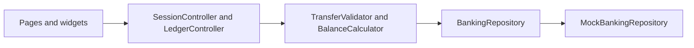

## Demo login

These accounts exist only inside the demo. They are not a GitHub login and they do not access a real service.

| Email | Password |
| --- | --- |
| avery.cole@finorax.dev | `demo1234` |

# FinoraX

Fictional digital banking and personal finance demo. Balances and transfers stay in a local mock ledger. Nothing here moves real money or stores card numbers.

**Stack:** Flutter 3.7.x · Dart 2.19.6 · Riverpod · GoRouter · MVVM with clean boundaries.

Suggested package id: `com.lalitdev.finorax`

## Features

- Splash, onboarding, and demo sign-in
- Account summaries and virtual card previews (last four digits only)
- Beneficiaries
- Simulated transfer with confirmation and receipt
- Transaction search, category filters, and pagination
- Spending chart, budgets, and savings goals
- Activity center
- Profile, theme preference, and sign-out

## Architecture



- Presentation: pages, shell, Riverpod notifiers
- Domain: entities, money in minor units, transfer rules, repository contract
- Data: seeded mock ledger
- Core: theme tokens, router, typed failures

## Demo access

| Field | Value |
| --- | --- |
| Email | avery.cole@finorax.dev |
| Password | demo1234 |

## Setup

```bash
flutter pub get
flutter run
```

Copy `.env.example` if you later point the app at a mock HTTP host. The default build does not call a network.

## Integrations

| Piece | Status |
| --- | --- |
| Accounts, transfers, budgets | Local mock data |
| Charts | fl_chart on device |
| Biometrics | Not connected. Labeled as unavailable |
| Card PAN / bank credentials | Not collected |
| Drift / SQLite | Not in this build. The ledger is in memory so widget tests stay hermetic |
| Secure storage | Session is not written to the keychain. The demo password is not saved |

## Tests

```bash
dart format .
flutter analyze
flutter test
```

Integration flow: `integration_test/demo_flow_test.dart`.

## Screenshots

Capture after `flutter run`:

1. Onboarding
2. Dashboard account cards
3. Transfer receipt
4. Spending chart

## Known limitations

- Not a bank. Do not enter real account or card data.
- Refreshing the process restores the seed ledger.
- Built and verified against Flutter 3.7.10 / Dart 2.19.6 on this machine. Newer Flutter can be adopted later with a dependency bump.
- No production auth, encryption review, or payment network.

## License

MIT. See `LICENSE`.
